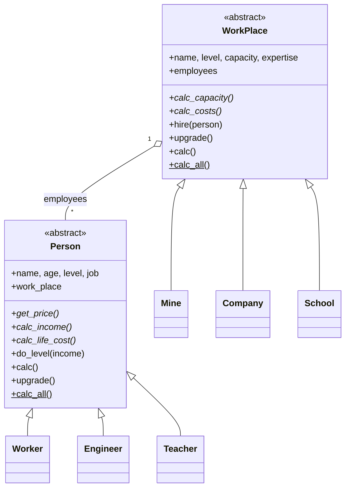

# Workplace Simulation

[](https://github.com/arminkhalilzadeh/Quera-Workplace-Simulation/actions/workflows/ci.yml)

[](LICENSE)

A small economic simulation written in Python to practise **object-oriented design**. People with
different jobs (`Worker`, `Engineer`, `Teacher`) are hired by workplaces (`Mine`, `Company`, `School`).
Each agent has a daily balance that depends on age, experience level and the workplace it belongs to.

Built as part of the *Advanced Python Programming and Object-Oriented Thinking* course at Quera College.

## Design



- **Abstract base classes** (`abc.ABC`) define the interface. Each subclass supplies its own economic rules.
- **Class-level registries** (`Person.instances`, `WorkPlace.instances`) let `calc_all()` add up the whole economy.
- **Two-way link** on hiring: `workplace.employees` ↔ `person.work_place`, with a capacity check that
  raises `WorkPlaceIsFull`.

## Model rules

**People:** a person's daily net balance is their income, scaled by their own level and their workplace's level, minus their cost of living:

$$\text{net} = \text{income}\cdot\sqrt{\text{level}_{person}\cdot\text{level}_{workplace}} - \text{life cost}$$

A person without a job only pays the cost of living.

| Job | Training price | Life cost | Income |
|---|---|---|---|
| Worker | falls with age (∝ 1/age) | rises with age (∝ age) | falls with age (∝ 1/age) |
| Engineer | ∝ √(15/age) | ∝ √(age/15) | ∝ √(15/age) |
| Teacher | falls linearly with age | rises linearly with age | falls linearly with age |

**Workplaces:** a workplace's daily balance is its maintenance cost, as a negative number.

| Workplace | Capacity at level *L* | Daily cost |
|---|---|---|
| Mine | *L*² | 2500 + 50·*L* |
| Company | *L* | 2500·*L* |
| School | ⌊√*L*⌋ | 2500·⌊√*L*⌋ |

All constants are kept in `Consts` classes, so they are easy to change.

## Quickstart

```bash
git clone https://github.com/arminkhalilzadeh/Quera-Workplace-Simulation.git
cd Quera-Workplace-Simulation
python -m venv .venv && source .venv/bin/activate   # Windows: .venv\Scripts\activate
pip install -e ".[dev]"

pytest              # run the test suite
python examples/demo.py
```

```python
from workplace_sim import Mine, Worker, WorkPlaceIsFull

mine = Mine("Kerman Mine")       # level 1 -> capacity 1
mine.hire(Worker("Amir", 18))
mine.upgrade()                   # level 2 -> capacity 4

print(mine.employees[0].calc())  # daily net balance of the worker
print(mine.calc())               # -(daily maintenance cost)
```

## Project structure

```
├── src/workplace_sim/
│   ├── people/          # Person (abstract), Worker, Engineer, Teacher
│   └── workplaces/      # WorkPlace (abstract), Mine, Company, School, WorkPlaceIsFull
├── tests/               # pytest suite (constructors, economics, hiring, aggregation)
├── examples/demo.py
├── pyproject.toml       # packaging, pytest and ruff configuration
└── .github/workflows/   # CI: lint and tests on Python 3.10–3.13
```

## License

[MIT](LICENSE) © Armin Khalilzadeh
